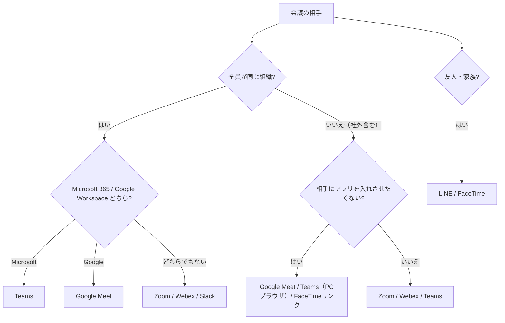

# 用途別選定ガイド

> 確認日: 2026年11月3日（皇紀2686年・令和8年）。信頼度: ✅公式確認 ／ 🔶二次情報 ／ ⚪一般 ／ ⚠️未確認

> 根拠は各ツールページの ✅ のみ。⚪ は一般的な助言。

## 1. 意思決定ツリー

## 2. 用途別 推奨（事実ベース）
| 用途 | 候補 | 根拠・注意 |
|---|---|---|
| 相手にアプリを入れさせない | Google Meet、Teams（PCブラウザ）、FaceTime リンク | ✅ Meet はブラウザ参加。Teams ブラウザは受信1ストリーム。FaceTime のホストは Apple 端末必須 |
| Microsoft 365 組織 | Teams | ✅ 最大300人（Business）／1,000人（Enterprise）|
| Google Workspace 組織 | Google Meet | ✅ 100/150/500/1,000人、録画は Standard 以上 |
| 大規模・ウェビナー | Teams（Enterprise）| ✅ 閲覧専用 10,000 人追加可 |
| 無料で少人数 | Google Meet（1対1は24時間）| ✅ 3人以上は60分 |
| 無料で短時間・100人 | Webex 無料 | ✅ 40分・100人・ローカル録画のみ |
| チャット中心のその場会議 | Slack ハドル | ✅ 無料は2人まで、有料50人 |
| 自前運用・オープンソース | Jitsi Meet | ✅ ローカル録画機能あり。自前は UDP 10000 設定が必要 |
| 友人・家族（Apple中心）| FaceTime | ✅ Android/Windows はブラウザ参加。画面共有不可 |
| 友人・家族（国内）| LINE | 🔶 上限等は要確認 |
| AI議事録を重視 | Teams（Premium/Copilot）、Meet（Gemini）、Webex（AI Assistant）| ✅ いずれも対象プラン・条件あり。[AI議事録](howto/ai-minutes.md) |

## 3. 選ばない理由が明確なもの
- Skype、Amazon Chime は提供終了 ✅（[Skype](tools/skype.md)／[Chime](tools/amazon-chime.md)）。

## 4. 端末環境で選ぶ
- iPad 中心: 画面共有は全画面・端末内音声が乗らない報告あり 🔶 → [iPadOS](platforms/ipados.md)
- 古いPC／低スペック: ブラウザ参加＋機能を絞る ⚪。Teams は Windows 10 (10.0.19041)・RAM 4GB が最小 ✅。
