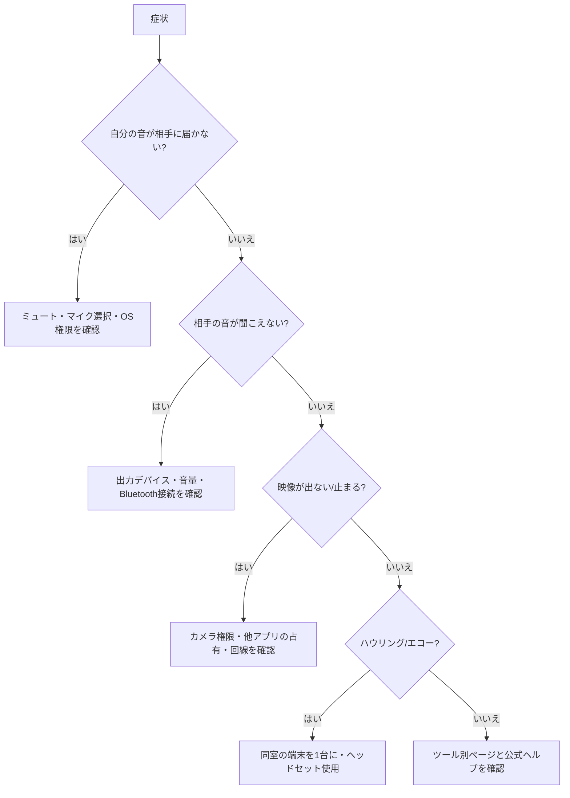

# 音声・映像トラブルの切り分け

> 確認日: 2026年11月3日（皇紀2686年・令和8年）／ 信頼度: ✅公式確認 ・🔶二次情報 ・⚪一般的知見（出典未検証）・⚠️未確認

## 1. 切り分けフロー ⚪

## 2. 症状別対処表 ⚪
| 症状 | 主な原因 | 対処 |
|---|---|---|
| 相手に声が届かない | アプリ内ミュート、別のマイクが選択、OS側でマイク拒否 | アプリ内の入力デバイスを選び直す。OSのプライバシー設定でマイクを許可。許可後はアプリ再起動 |
| 音が小さい／途切れる | Bluetooth の通話モード、入力ゲイン、ノイズ除去の過剰 | 有線または別のヘッドセットで比較。ツールの音量自動調整を調整 |
| 映像が真っ黒 | 他アプリがカメラを使用中、カメラ権限なし、物理シャッター | 他アプリを終了。権限とカメラ切替を確認 |
| 映像が荒い／カクつく | 回線帯域、端末のCPU負荷、受信画質設定 | 仮想背景を切る、ギャラリー表示を減らす、Wi-Fi 5GHz または有線に |
| ハウリング／エコー | 同室で複数端末が音を出している | 1台だけ音声参加。他はミュートとスピーカーオフ |
| 参加できない | 会議の有効期限、待機室、パスコード、組織ポリシー | 主催者に確認。別ブラウザで試す |
| 画面共有が黒い | macOS の画面収録権限、DRM 保護コンテンツ | 権限を付与しアプリ再起動。保護コンテンツは共有不可のことがある |

## 3. 事前テストのすすめ ⚪
開始前に5分、ツール内の「音声・映像テスト」またはテスト会議で、マイク・スピーカー・カメラ・画面共有・録画保存先を確認する。

## 4. 参考
- Teams AVD 環境ではメディア最適化が必要 ✅（[Teams](../tools/microsoft-teams.md)）。
- 各OSの権限: [Windows](../platforms/windows.md) / [macOS](../platforms/macos.md) / [Android](../platforms/android.md) / [iPadOS](../platforms/ipados.md)
